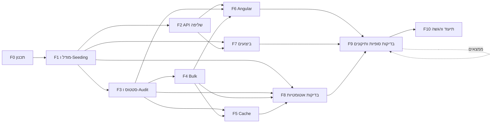

# תוכנית עבודה וחלוקה למשימות

מסמך זה מתרגם את אפיון המבדק לתוכנית עבודה: ניתוח פערים מול הקוד הקיים, חלוקה ל-Features ו-Tasks, תלויות, סדר ביצוע, הערכת מאמץ ומיפוי לדרישות.

> סימון סעיפי דרישה: `R1`–`R11` לפי מספור הסעיפים באפיון (R1 שליפת נתונים … R11 תיעוד).

---

## 1. נקודת מוצא – ניתוח פערים

> **הערה לגבי הקוד הקיים:** חלק מהקוד היה קיים עוד לפני תחילת המבדק הנוכחי. בעבר ניגשתי למשרה במשרד להגנת הסביבה, ובמבדק שם ניתן אותו בסיס פרויקט. השתמשתי בבסיס הזה כנקודת מוצא, והמבדק הנוכחי נבנה מעליו.

הפרויקט הקיים מכיל בסיס עובד: API לשליפה עם דפדוף/סינון/מיון בצד השרת, Summary, עדכון סטטוס עם RowVersion, ממשק Angular עם debounce ו-`switchMap`, ו-9 בדיקות backend מול InMemory.

| דרישה | מצב | פער |
|---|---|---|
| R1 שדה `AssignedTo` | ❌ | חסר בישות, ב-DTO, ב-Seeder וב-UI |
| R1 100,000 רשומות + יצירה חוזרת | ⚠️ | ה-Seeder יוצר 12,000, ורק כשהטבלה ריקה; אין דרך ליצור מחדש |
| R1 סינון משולב | ⚠️ | קיים Status/Priority בלבד; חסרים OrganizationName, AssignedTo, טווח תאריכים |
| R1 חיפוש ב-Title/OrganizationName | ✅ | `Contains` → `LIKE '%x%'` (לא sargable – לתעד) |
| R1 מיון ≥3 שדות Asc/Desc | ✅ | 4 שדות, whitelist |
| R1 ≥2 Aggregations | ✅ | לפי Status ולפי Priority |
| R1 הגבלת PageSize, Validation, CancellationToken, DTOs | ✅ | חסרה ולידציה ל-`from <= to` (ייווסף עם טווח התאריכים) |
| R1 תיעוד מניעת טעינה לזיכרון + אינדקסים | ⚠️ | קיים חלקית ב-README; צריך לעדכן לאינדקסים החדשים |
| R2 404 / סטטוס לא חוקי | ✅ | |
| R2 מעבר סטטוס לא מותר | ❌ | אין מדיניות מעברים |
| R2 Optimistic Concurrency, UpdatedAt/RowVersion | ✅ | נאכף ב-DB באמצעות `rowversion` |
| R3 Audit + Endpoint היסטוריה | ❌ | חסר לגמרי |
| R4 Bulk עד 100 | ❌ | חסר לגמרי |
| R5 Angular – debounce, ביטול בקשות, מצבי Loading/Empty/Error, 409, Aggregations | ✅ | |
| R5 צפייה בהיסטוריה, פילטרים חדשים | ❌ | |
| R6 Execution Plan, אינדקסים, Bottleneck על 100K | ❌ | לא נמדד ולא תועד (נבדק רק מול 12K) |
| R7 Cache + Invalidation + Scale-out | ❌ | חסר; ה-README מציין זאת כ"שיפור עתידי" |
| R8 Integration Test (API + DB) | ❌ | כל הבדיקות הן Unit מול InMemory |
| R8 Concurrency / Validation / תרחיש תקין | ✅ | ברמת Service |
| R9 תוכנית עבודה | ❌ | המסמך הזה |
| R10 איכות קוד | ⚠️ | המיפוי Entity→DTO משוכפל ב-`RequestService`; ה-Logging מינימלי |
| R11 תיעוד | ⚠️ | ה-README מתאר גרסה קודמת ("האתגר שנבחר"); חסרים Cache, Bulk, Audit, מגבלה ידועה, פירוט AI |

---

## 2. החלטות תכנון שנדרשות לפני הפיתוח

| # | החלטה | הצעה | נימוק |
|---|---|---|---|
| D1 | מדיניות מעברי סטטוס | `New→InProgress`, `InProgress→Waiting/Completed`, `Waiting→InProgress/Completed`, `Completed` סופי; מעבר לאותו סטטוס נדחה | פשוט, ניתן לבדיקה, ומונע "קפיצה" ישירה מ-New ל-Completed |
| D2 | זהות `ChangedBy` ללא Authentication | Header `X-User-Name` (חובה בעדכון, אורך מוגבל), עם נקודת החלפה אחת (`ICurrentUser`) | אין מערכת הזדהות במבדק; כך המעבר ל-JWT בעתיד הוא שינוי במקום אחד |
| D3 | התנהגות Bulk | **Partial Success** – כל פנייה מעודכנת בטרנזקציה משלה; התשובה מכילה תוצאה לכל פנייה (`Updated` / `NotFound` / `Conflict` / `InvalidTransition`) | לכל פנייה RowVersion נפרד, ומקובל שמשתמשים אחרים עדכנו חלק מהפניות. All-or-Nothing היה מכשיל 99 עדכונים תקינים בגלל קונפליקט אחד ומאלץ את המשתמש לנסות שוב בלולאה |
| D4 | מה נשמר ב-Cache | ה-Summary (Aggregations על כל הטבלה) ב-`IMemoryCache`, Expiration של 60 שניות + Invalidation בכל שינוי סטטוס | זו השאילתה היקרה ביותר, הנקראת בכל טעינת מסך, והתוצאה זהה לכל המשתמשים. רשימות מסוננות לא נשמרות: מרחב המפתחות גדול מדי ו-Invalidation שלהן מורכב |
| D5 | DB לבדיקות אינטגרציה | `WebApplicationFactory` + SQL Server אמיתי (LocalDB עם DB ייחודי לכל הרצה, או Testcontainers אם Docker זמין) | InMemory לא אוכף `rowversion` ולא מתרגם ל-SQL, כך שלא בודק את מנגנון ה-Concurrency האמיתי |
| D6 | Seeding של 100K | הכנסה ב-batches עם `AutoDetectChanges` כבוי (או `SqlBulkCopy` אם עדיין איטי); יצירה מחדש באמצעות `dotnet run -- --reseed` | זמן עלייה סביר ושחזור דטרמיניסטי של הנתונים לפי דרישה |

---

## 3. חלוקה ל-Features ו-Tasks

ההערכות כוללות בדיקה ידנית של כל משימה.

**חלוקת הזמן:**
- **תכנון (F0):** 5 שעות. זה השלב שקובע את כל השאר.
- **בדיקות סופיות ותיקונים (F9):** 4 שעות.
- **תיעוד והגשה (F10):** שעתיים וחצי.
- **כל שלב פיתוח (F1–F8):** עד שעה וחצי, לפי ההיקף שלו, בצעדים של רבע שעה:
  - הגדול ביותר (F6): שעה וחצי.
  - קטנים ממנו (F1, F8): שעה ורבע.
  - F3, F7: שעה.
  - F2, F4: 45 דקות.
  - F5: 30 דקות.

### F0 – ניתוח ותכנון (5 שעות)
| ID | משימה | תוצר מצופה | תלוי ב- | הערכה | דרישה |
|---|---|---|---|---|---|
| T0.1 | ניתוח פערים בין האפיון לקוד הקיים | טבלת פערים (סעיף 1) | – | 2 שעות | R9 |
| T0.2 | קבלת החלטות D1–D6 | טבלת החלטות (סעיף 2) | T0.1 | 1.5 שעות | R2, R4, R7, R9 |
| T0.3 | תוכנית עבודה, תלויות והערכות | מסמך זה | T0.2 | 1.5 שעות | R9 |

### F1 – מודל נתונים ו-Seeding (שעה ורבע)
| ID | משימה | תוצר מצופה | תלוי ב- | הערכה | דרישה |
|---|---|---|---|---|---|
| T1.1 | הוספת `AssignedTo` לישות ולקונפיגורציה (nvarchar(100), required) | Migration + עדכון `RequestEntity`/`RequestConfiguration` | T0.2 | 5 דק' | R1 |
| T1.2 | ישות `RequestStatusHistory` (Id, RequestId FK, PreviousStatus, NewStatus, ChangedAt, ChangedBy) עם אינדקס `(RequestId, ChangedAt)` | Migration + Configuration | T0.2 | 15 דק' | R3 |
| T1.3 | הרחבת ה-Seeder ל-100,000 רשומות כולל `AssignedTo` ופיזור סביר של ארגונים/מטפלים, הכנסה ב-batches | Seeder דטרמיניסטי; זמן seeding מתועד | T1.1 | 30 דק' | R1 |
| T1.4 | יצירה חוזרת של נתוני הבדיקה (`--reseed`: מחיקה ו-seeding מחדש) | פקודה מתועדת ב-README | T1.3 | 5 דק' | R1 |
| T1.5 | תכנון אינדקסים מחדש לפי תרחישי הסינון החדשים (`AssignedTo`, `OrganizationName`, טווח `CreatedAt`), בלי לשכפל אינדקסים קיימים | Migration + הערה לכל אינדקס: איזה תרחיש הוא משרת | T1.1 | 20 דק' | R1, R6 |

### F2 – API שליפה (45 דקות)
| ID | משימה | תוצר מצופה | תלוי ב- | הערכה | דרישה |
|---|---|---|---|---|---|
| T2.1 | הרחבת `RequestQueryDto`: `OrganizationName`, `AssignedTo`, `CreatedFrom`, `CreatedTo` + ולידציה (`from <= to`, אורכי מחרוזות). בנוסף: הוספת `ThenBy(Id)` כ-tiebreaker לכל מיון (נמצא ב-T1.5: מיון לפי עמודה לא ייחודית גורם לדפדוף לא דטרמיניסטי – שורות כפולות/חסרות בין עמודים; ה-Id כבר חלק ממפתח כל אינדקס non-clustered ולכן אין עלות) | סינון משולב ב-`GetRequestsAsync`, דפדוף יציב, 400 ProblemDetails לקלט לא תקין | T1.1 | 25 דק' | R1 |
| T2.2 | ריכוז המיפוי Entity→DTO ב-Projection אחד (`Expression`) לשימוש בשליפה ובעדכון | הסרת שכפול; DTO כולל `AssignedTo` | T1.1 | 10 דק' | R1, R10 |
| T2.3 | תיעוד: איך נמנעת טעינת הנתונים לזיכרון (`IQueryable` עד `ToListAsync`, `Skip/Take` ב-SQL, `AsNoTracking`, Projection) | סעיף ב-README | T2.1 | 10 דק' | R1, R11 |

### F3 – עדכון סטטוס, מעברים ו-Audit (שעה)
| ID | משימה | תוצר מצופה | תלוי ב- | הערכה | דרישה |
|---|---|---|---|---|---|
| T3.1 | מדיניות מעברי סטטוס (`StatusTransitionPolicy`) לפי D1 | 400 עם הודעה ברורה ("Cannot change status from X to Y") | T0.2 | 15 דק' | R2 |
| T3.2 | `ICurrentUser` שקורא את `X-User-Name` + ולידציה | שירות Scoped; 400 כשחסר | T0.2 | 10 דק' | R3 |
| T3.3 | כתיבת רשומת Audit באותו `SaveChanges` של העדכון (אטומי: אין עדכון בלי Audit ולהפך) | שורת היסטוריה לכל שינוי סטטוס | T1.2, T3.1, T3.2 | 15 דק' | R3 |
| T3.4 | `GET /api/requests/{id}/history` (ממוין לפי `ChangedAt` desc, 404 אם הפנייה לא קיימת) | Endpoint + DTO | T3.3 | 10 דק' | R3 |
| T3.5 | Logging בנקודות משמעותיות: עדכון, Conflict, Bulk summary, reseed. בלי תוכן הפנייה ובלי ערכי Header | לוגים מובנים | T3.3 | 10 דק' | R10 |

### F4 – עדכון Bulk (45 דקות)
| ID | משימה | תוצר מצופה | תלוי ב- | הערכה | דרישה |
|---|---|---|---|---|---|
| T4.1 | חוזה API: `POST /api/requests/status/bulk` עם `{ status, items: [{ id, rowVersion }] }`; ולידציה ל-1–100 פריטים וללא מזהים כפולים | DTOs + תיעוד חוזה | T3.1 | 10 דק' | R4 |
| T4.2 | מימוש Partial Success (D3): טעינת הפניות בשאילתה אחת, עדכון כל פנייה בטרנזקציה נפרדת עם RowVersion משלה ו-Audit, וניתוק הישויות של פריט שנכשל מה-`DbContext` | `200` עם `{ updated, failed, results[] }`, כולל RowVersion חדש לכל פנייה שעודכנה | T4.1, T3.3 | 35 דק' | R4, R2 |

### F5 – Cache (30 דקות)
| ID | משימה | תוצר מצופה | תלוי ב- | הערכה | דרישה |
|---|---|---|---|---|---|
| T5.1 | Cache ל-Summary ב-`IMemoryCache` (AbsoluteExpiration 60s) | `GetSummaryAsync` מחזיר מה-Cache כשאפשר | – | 10 דק' | R7 |
| T5.2 | Invalidation אחרי עדכון בודד, אחרי Bulk (אם עודכנה לפחות פנייה אחת) ואחרי reseed | אין נתון מיושן אחרי שינוי באותו מופע | T5.1, T3.3, T4.2 | 10 דק' | R7 |
| T5.3 | תיעוד Scale-out: מעבר ל-`IDistributedCache` (Redis), מפתח עם גרסה; ה-Expiration הקצר מגביל את חלון הנתון המיושן | סעיף ב-README | T5.2 | 10 דק' | R7, R11 |

### F6 – Angular (שעה וחצי)
| ID | משימה | תוצר מצופה | תלוי ב- | הערכה | דרישה |
|---|---|---|---|---|---|
| T6.1 | עדכון מודלים ו-`RequestsService`: `assignedTo`, פילטרים חדשים, `getHistory`, `bulkUpdateStatus`, Header `X-User-Name` דרך interceptor | Service מלא מול ה-API | T2.1, T3.4, T4.1 | 10 דק' | R5 |
| T6.2 | פילטרים: ארגון, מטפל, טווח תאריכים (Datepicker) בתוך זרם ה-debounce הקיים | סינון משולב בצד השרת | T6.1 | 15 דק' | R5 |
| T6.3 | עמודת `AssignedTo` בטבלה | – | T6.1 | 5 דק' | R5 |
| T6.4 | קומפוננטת היסטוריה (Dialog) עם מצבי Loading/Empty/Error | צפייה בהיסטוריה מכל שורה | T6.1 | 15 דק' | R5, R3 |
| T6.5 | בחירת סטטוס שמציגה רק מעברים מותרים, וטיפול ב-400 (מעבר לא חוקי) לצד 409 הקיים | UX עקבי מול השרת | T6.1, T3.1 | 10 דק' | R5, R2 |
| T6.6 | Bulk: בחירת שורות (Checkbox), סרגל פעולה ותצוגת תוצאה ("עודכנו 8, נכשלו 2 – קונפליקט"), ואז ריענון | פעולת Bulk מלאה | T6.1, T4.2 | 20 דק' | R5, R4 |
| T6.7 | בדיקות Vitest לפילטרים החדשים, להיסטוריה ול-Bulk | specs עוברים | T6.2–T6.6 | 15 דק' | R8 |

### F7 – ביצועים (שעה)
| ID | משימה | תוצר מצופה | תלוי ב- | הערכה | דרישה |
|---|---|---|---|---|---|
| T7.1 | מדידה על 100K רשומות של `GET /api/requests` (פילטר משולב + מיון + עמוד עמוק), חיפוש טקסט ו-Summary: Actual Execution Plan + `SET STATISTICS IO, TIME` לפני ואחרי האינדקסים | טבלת logical reads / זמן + אופרטורי Plan | T1.3, T1.5, T2.1 | 40 דק' | R6 |
| T7.2 | `docs/PERFORMANCE.md`: האינדקסים והסיבה לכל אחד, ה-Bottlenecks והשיפורים המוצעים | מסמך ביצועים | T7.1 | 20 דק' | R6, R11 |

### F8 – בדיקות אוטומטיות (שעה ורבע)
| ID | משימה | תוצר מצופה | תלוי ב- | הערכה | דרישה |
|---|---|---|---|---|---|
| T8.1 | תשתית Integration: `WebApplicationFactory` + SQL Server אמיתי (D5), DB ייחודי לכל הרצה ונתוני בדיקה קטנים | פרויקט `RequestsManagement.IntegrationTests` | T1.1, T1.2 | 25 דק' | R8 |
| T8.2 | Integration – תרחיש תקין: `GET` עם סינון משולב, מיון ודפדוף דרך HTTP | בדיקה עוברת | T8.1, T2.1 | 10 דק' | R8 |
| T8.3 | Integration – Concurrency: שני `PATCH` עם אותו RowVersion → אחד `200`, השני `409`. בנוסף: קונפליקט שמתגלה רק ב-`SaveChanges` (כותב מתחרה בין הטעינה לשמירה, באמצעות `SaveChangesInterceptor`) → שורת ההיסטוריה מתבטלת יחד עם ה-UPDATE. הועבר מ-T3.3: ספק InMemory אינו תומך בטרנזקציות ולכן אינו יכול לאמת זאת | בדיקה עוברת מול `rowversion` וטרנזקציה אמיתיים | T8.1, T3.3 | 15 דק' | R8, R2, R3 |
| T8.4 | Validation: מעבר לא חוקי, `pageSize > 100`, `from > to`, Bulk עם יותר מ-100 פריטים → `400` ProblemDetails | בדיקות עוברות | T3.1, T4.1 | 10 דק' | R8 |
| T8.5 | Bulk Partial Success: פנייה קיימת + פנייה לא קיימת + RowVersion מיושן → תוצאה נכונה לכל פריט | בדיקה עוברת | T4.2 | 5 דק' | R8, R4 |
| T8.6 | Audit + History: אחרי עדכון נוצרת שורת היסטוריה נכונה ו-Endpoint ההיסטוריה מחזיר אותה | בדיקה עוברת | T3.4 | 5 דק' | R8, R3 |
| T8.7 | Cache: קריאה שנייה מגיעה מה-Cache, ואחרי עדכון מוחזר ערך מעודכן | בדיקה עוברת | T5.2 | 5 דק' | R8, R7 |

### F9 – בדיקות סופיות ותיקונים (4 שעות)

**המטרה:** לבחון את כל מה שנבנה ב-F1–F8 מנקודת המבט של הבודק, לפני כתיבת התיעוד הסופי. השלב הזה מגיע לפני התיעוד בכוונה: התיעוד ב-F10 צריך לתאר את הקוד אחרי התיקונים, ולא לפניהם.

כאן מתוכנן **מה** ייבדק, **איך** ייבדק ו**מתי הבדיקה נחשבת עוברת**. התוצאות לא נרשמות כאן. כל ממצא נרשם ברשימת ממצאים, מסווג לפי חומרה ומטופל ב-T9.8.

**כלל ההיקף:** מתקנים רק את מה שנגזר מהאפיון (R1–R11), או בעיות איכות, אבטחה ונכונות בקוד שכבר נכתב. לא מוסיפים פיצ'רים שלא נדרשו, כמו Authentication, Rate Limiting או Full-Text Search. הצעות שמחוץ להיקף נרשמות ב"מה הייתי משפר" ב-README, ולא נכנסות לקוד.

**סיווג ממצאים:**

| חומרה | הגדרה | טיפול |
|---|---|---|
| Critical | דרישה חסרה, באג שמשבש נתונים, או פרצת אבטחה | חובה לתקן |
| High | דרישה ממומשת חלקית, באג בתרחיש סביר, או דרישה בלי בדיקה | חובה לתקן |
| Medium | Code smell, חוסר עקביות, או תיעוד לא מדויק | מתקנים אם זה בהיקף. אחרת, נימוק מתועד |
| Low | סגנון או Naming | מתקנים אם זה זול |

| ID | בדיקה | מה בודקים | איך | עוברת כאשר | תלוי ב- | הערכה | דרישה |
|---|---|---|---|---|---|---|---|
| T9.1 | **עמידה בדרישות** | כל משפט-דרישה באפיון, ולא רק R1–R11 ברמה הכללית | מטריצת Traceability: לכל פריט, איפה הוא ממומש (קובץ), איזו בדיקה מכסה אותו ואיפה הוא מתועד | לכל פריט יש מימוש, בדיקה ותיעוד. פריט שחסר לו אחד מהשלושה נרשם כממצא | F1–F8 | 30 דק' | R1–R11 |
| T9.2 | **Code Review ל-Backend** | <ul><li>Controller דק, והלוגיקה ב-Service</li><li>שכפול, Naming ו-Nullable</li><li>DI lifetimes</li><li>`CancellationToken` עד ה-DB, ו-Async בלי `.Result` / `.Wait()`</li><li>EF: Tracking, Projection, N+1 וטרנזקציות</li><li>עקביות של ProblemDetails, קודי HTTP ורמות Logging</li></ul> | קריאה ידנית של הקוד, `dotnet build -warnaserror`, `dotnet format --verify-no-changes`, `/code-review` | אין אזהרות build, הפורמט נקי, ואין ממצא Critical/High פתוח | T9.1 | 30 דק' | R10 |
| T9.3 | **Code Review ל-Frontend** | <ul><li>מבנה core/shared/features</li><li>Typing מלא, בלי `any`</li><li>ניהול Subscriptions (`takeUntilDestroyed`)</li><li>ביטול בקשות</li><li>מצבי Loading/Empty/Error בכל מסך</li><li>הפרדה בין Components ל-Services</li><li>נגישות בסיסית (labels, aria) ו-RTL</li></ul> | קריאה ידנית, `ng build` לייצור | build לייצור בלי שגיאות, ואין ממצא Critical/High פתוח | T9.1 | 20 דק' | R5, R10 |
| T9.4 | **Security Review** | <ul><li>ולידציה לכל קלט: Query, Body וה-Header `X-User-Name` (אורך, תווים, Log Injection)</li><li>אין SQL דינמי</li><li>DTO נפרד מה-Entity (אין Mass Assignment)</li><li>אין דליפת Stack Trace או פרטי DB</li><li>CORS מוגבל ל-origin של ה-UI</li><li>הגבלת גודל ב-Bulk</li><li>אין סודות בריפו</li><li>אין XSS ב-Angular (`innerHTML`, `bypassSecurityTrust*`)</li></ul> | קריאה ידנית, `dotnet list package --vulnerable --include-transitive`, `npm audit`, `/security-review` | אין פגיעות High/Critical בחבילות ואין ממצא Critical/High פתוח. הזהות מבוססת Header (D2) מתועדת כמגבלה ידועה | T9.1 | 30 דק' | R2, R3, R4, R10 |
| T9.5 | **בדיקות אוטומטיות והרצה מ-clone נקי** | <ul><li>כל הבדיקות רצות מ-clone נקי, בלי צעדים שלא כתובים ב-README</li><li>מקרי קצה: `pageSize` 0/1/100/101, Bulk עם 0/1/100/101 פריטים, מזהים כפולים, מחרוזות ריקות ו-Unicode, from שווה ל-to</li><li>בדיקות לא יציבות (flaky)</li></ul> | `git clone` לתיקייה חדשה, הרצה לפי ה-README בלבד, `dotnet test`, `ng test`, Coverage (`coverlet` / `vitest --coverage`) | כל הבדיקות עוברות בשתי הרצות ברצף, ולכל דרישה ב-T9.1 יש לפחות בדיקה אחת | T9.1 | 25 דק' | R8, R11 |
| T9.6 | **בדיקה ידנית מקצה לקצה בדפדפן** | <ul><li>חיפוש עם debounce</li><li>כל הסינונים והמיונים</li><li>דפדוף</li><li>מצבי Loading/Empty/Error</li><li>עדכון סטטוס בודד</li><li>409 משתי לשוניות על אותה פנייה</li><li>מעבר לא מותר</li><li>עדכון בלי שם משתמש</li><li>היסטוריה</li><li>Bulk עם הצלחה חלקית</li><li>רענון ה-Aggregations</li><li>מסך צר</li></ul> | הרצת ה-API וה-UI מול 100K רשומות, מעבר על רשימת התרחישים, ובדיקה ב-Network tab שאין בקשות כפולות ושבקשות קודמות מבוטלות | כל תרחיש מתנהג כמתואר ב-README | T9.5 | 30 דק' | R2–R5 |
| T9.7 | **ביצועים** | שה-Plans והמדידות ב-`docs/PERFORMANCE.md` עדיין נכונים לקוד הסופי, ושאין N+1 ב-Bulk ובהיסטוריה | הרצה חוזרת של `docs/perf/measure-queries.sql` ו-`measure-improvements.sql` על 100K, ו-SQL logging של EF בזמן Bulk | אין Plan שהשתנה לרעה, והמספרים במסמך תואמים להרצה | T9.1 | 15 דק' | R6, R7 |
| T9.8 | **סבב תיקונים** | כל ממצא Critical/High מ-T9.1–T9.7, וכל Medium שבהיקף | כל תיקון בקומיט נפרד, עם בדיקה שמכסה אותו. אחרי הסבב: הרצה חוזרת של הבדיקות ושל ה-Review באזורים שהשתנו | עמידה ב-Definition of Done | T9.2–T9.7 | 60 דק' | כולן |

**Definition of Done ל-F9:**
- `dotnet build` ו-`ng build` לייצור עוברים בלי אזהרות, ו-`dotnet format` נקי.
- כל הבדיקות עוברות: Unit ו-Integration ב-Backend, ו-Vitest ב-Frontend.
- אין חבילות עם פגיעות ברמת High או Critical.
- לכל תת-דרישה באפיון יש במטריצה מימוש, בדיקה ותיעוד.
- אין ממצא פתוח ברמת Critical או High. ממצא Medium נשאר פתוח רק עם נימוק מתועד.

### F10 – תיעוד והגשה (שעתיים וחצי)

השלב האחרון: התיעוד נכתב אחרי שהקוד עבר את הבדיקות הסופיות, כך שהוא מתאר את מה שבאמת מוגש.

| ID | משימה | תוצר מצופה | תלוי ב- | הערכה | דרישה |
|---|---|---|---|---|---|
| T10.1 | שכתוב README: הוראות הרצה, טכנולוגיות וגרסאות, מבנה הפתרון, בסיס הנתונים והאינדקסים, Concurrency, Bulk, Cache ו-Invalidation | README מלא שתואם את הקוד | F9 | 60 דק' | R11 |
| T10.2 | שתי החלטות טכנולוגיות משמעותיות והחלופות שנשקלו, מגבלה ידועה, ודבר שהיה אפשר לשפר | סעיף ב-README | T10.1 | 25 דק' | R11 |
| T10.3 | פירוט שימוש ב-AI: באילו חלקים נעשה שימוש, ומה נבדק או שונה ידנית | סעיף ב-README | T10.1 | 15 דק' | R11 |
| T10.4 | אימות התיעוד מול הקוד: מספר הבדיקות, שמות קבצים, Endpoints, פרמטרים ומדידות. בנוסף: הקישורים עובדים, ותוכנית העבודה משקפת את מה שבוצע (סטיות מתועדות) | מסמכים מדויקים | T10.1–T10.3 | 20 דק' | R9, R11 |
| T10.5 | הגשה: העלאה ל-GitHub (ריפו נגיש לבודקים), כל המסמכים מקושרים מה-README, והרצה אחרונה מ-clone נקי | קישור הגשה | T10.4 | 30 דק' | הגשה |

---

## 4. סדר ביצוע ותלויות

**שלבים:**

1. **תכנון (5 שעות):** F0. ניתוח הפערים, ההחלטות והתוכנית מגדירים את כל מה שבא אחריהם.
2. **יסודות (שעה ורבע):** F1. ה-Migrations (T1.1, T1.2), ואחריהם ה-Seeder ויצירה חוזרת (T1.3, T1.4) והאינדקסים (T1.5). בלי המודל המעודכן אין טעם להתחיל לעבוד על ה-API או על ה-UI.
3. **Backend (כ-2.5 שעות):**
   - F2 ו-F3 במקביל, ואחריהם F4 ו-F5.
   - התשתית של T8.1 נבנית כבר בשלב הזה, כך שבדיקות האינטגרציה נכתבות יחד עם הפיצ'ר ולא בסוף.
4. **Frontend וביצועים (כ-2.5 שעות):**
   - F6 מול ה-API המוגמר.
   - במקביל F7, כי הוא תלוי רק ב-Seeder, באינדקסים וב-T2.1. ייתכן שממצאי F7 יחזירו שינוי לאינדקסים ב-T1.5.
5. **השלמת הבדיקות האוטומטיות (שעה ורבע):** F8.
6. **בדיקות סופיות ותיקונים (4 שעות):** F9.
   - קודם בדיקת העמידה בדרישות (T9.1), כי היא מגדירה מה כל Review צריך לחפש.
   - אחריה ה-Reviews והבדיקות (T9.2–T9.7), שאפשר להריץ במקביל.
   - בסוף סבב התיקונים (T9.8), עד עמידה ב-Definition of Done.
7. **תיעוד והגשה (שעתיים וחצי):** F10, השלב האחרון. התיעוד מתאר את הקוד הסופי, ורק אז מגישים.

**הנתיב הקריטי:** T0.1 → T0.3 → T1.1 → T1.2 → T3.1 → T3.3 → T4.2 → T6.6 → T9.1 → T9.8 → T10.1 → T10.4 → T10.5.

---

## 5. סיכום מאמץ

| Feature | זמן |
|---|---|
| F0 תכנון | 5 שעות |
| F1 מודל ו-Seeding | שעה ורבע |
| F2 API שליפה | 45 דקות |
| F3 סטטוס ו-Audit | שעה |
| F4 Bulk | 45 דקות |
| F5 Cache | 30 דקות |
| F6 Angular | שעה וחצי |
| F7 ביצועים | שעה |
| F8 בדיקות אוטומטיות | שעה ורבע |
| F9 בדיקות סופיות ותיקונים | 4 שעות |
| F10 תיעוד והגשה | שעתיים וחצי |
| **סה"כ** | **19.5 שעות (כ-2.5 ימי עבודה)** |

רזרבה מומלצת: 15%, כ-3 שעות. מקורות הסיכון העיקריים:
- זמן ה-Seeding של 100K רשומות.
- הקמת SQL Server לבדיקות האינטגרציה.
- ממצאי ביצועים שיחייבו שינוי אינדקסים.
- כמות הממצאים ב-F9, שקובעת את היקף סבב התיקונים (T9.8).

---

## 6. מיפוי דרישות → משימות

| דרישה | משימות |
|---|---|
| R1 שליפת נתונים | T1.1, T1.3, T1.4, T1.5, T2.1, T2.2, T2.3 |
| R2 סטטוס ותחרותיות | T3.1, T4.2, T6.5, T8.3, T9.6 |
| R3 היסטוריית שינויים | T1.2, T3.2, T3.3, T3.4, T6.4, T8.6, T9.6 |
| R4 Bulk | T0.2 (D3), T4.1, T4.2, T6.6, T8.5, T9.6 |
| R5 Angular | T6.1–T6.7, T9.3, T9.6 |
| R6 ביצועים | T1.5, T7.1, T7.2, T9.7 |
| R7 Cache | T0.2 (D4), T5.1, T5.2, T5.3, T8.7, T9.7 |
| R8 בדיקות | T8.1–T8.7, T6.7, T9.5 |
| R9 תכנון עבודה | T0.1, T0.2, T0.3, T10.4 |
| R10 איכות קוד | T2.2, T3.5, T9.2, T9.3, T9.4 |
| R11 תיעוד | T2.3, T5.3, T7.2, T10.1, T10.2, T10.3, T10.4 |
| כל הדרישות – אימות סופי | T9.1 (מטריצת Traceability), T9.8 (תיקונים) |
| הגשה | T10.5 |

---

## 7. ביצוע בפועל: סטיות מהתוכנית

כל המשימות בוצעו לפי הסדר שבסעיף 4. בטבלה מתועד מה השתנה תוך כדי הביצוע, ולמה.

| משימה | מה תוכנן | מה בוצע בפועל | למה |
|---|---|---|---|
| T1.3 | Seeder ל-100,000 רשומות | בנוסף: כ-200 ארגונים (ארגון × סניף) והתפלגות לא אחידה של סטטוסים ועדיפויות | בהתפלגות אחידה סינון לפי ארגון לא היה סלקטיבי, והמדידה ב-F7 לא הייתה משקפת מערכת אמיתית |
| T1.5 → T2.1 | אינדקסים לסינונים החדשים | בנוסף: `Id` כ-tiebreaker בכל מיון | המדידה הראתה שמיון לפי עמודה לא ייחודית גורם לדפדוף לא דטרמיניסטי. ה-`Id` כבר חלק ממפתח כל אינדקס, ולכן אין עלות |
| T3.1 | 400 למעבר לא מותר | בנוסף: בדיקת RowVersion מוקדמת, שמחזירה 409 לפני בדיקת המעבר | לקוח שהנתון אצלו מיושן צריך לקבל "רענן", ולא 400 על מעבר מסטטוס שהוא לא ראה |
| T3.3 → T8.3 | בדיקה ש-Audit מתבטל בקונפליקט | הבדיקה הועברה ל-Integration | ספק InMemory לא תומך בטרנזקציות, ולכן לא יכול לאמת אטומיות |
| T3.5 | Logging בנקודות משמעותיות | בנוסף: בקשה שהלקוח ביטל נרשמת כ-Information (499) ולא כ-500 | `switchMap` מבטל בקשות בכל חיפוש מהיר, וכל ביטול נרשם כ-Error עם Stack Trace |
| T4.2 | `ChangeTracker.Clear()` בין פריטי Bulk | ניתוק הישויות של פריט שנכשל בלבד | `Clear` היה מנתק גם את הפניות שעוד לא עובדו, כי כולן נטענות מראש בשאילתה אחת |
| T5.2 | Invalidation אחרי שינוי | בנוסף: מספר גרסה במפתח ה-Cache | בלעדיו, קורא שחישב לפני ה-commit יכול לשמור תוצאה ישנה אחרי ה-Invalidation |
| T6.1 | Interceptor ל-`X-User-Name` | בנוסף: שדה שם בסרגל העליון, ותיקון של בחירת הסטטוס שהציגה ערך שלא נשמר | בלי שם, כל עדכון נכשל. בחירת הסטטוס נשארה על הערך שנבחר גם כשהעדכון נדחה |
| T6.2 | פילטרים לארגון ולמטפל | נוסף Endpoint: `GET /api/requests/filter-options` | הסינון הוא התאמה מדויקת (כדי לנצל אינדקס), ולכן נדרשת רשימת בחירה ולא טקסט חופשי |
| T6.5 | הצגת מעברים מותרים בלבד | המעברים המותרים מגיעים מהשרת (`allowedNextStatuses`) | כך הכללים נשארים במקום אחד, בלי העתק ב-TypeScript |
| מיון | `status` / `priority` / `createdAt` / `updatedAt` | `createdAt` / `updatedAt` / `organizationName` / `priority` / `id` | החלטה: לסטטוס ולמטפל יש מעט ערכים וסינון משלהם. לעדיפות יש סדר עסקי. לארגון יש כ-200 ערכים |
| F7 | מדידה והצעת שיפורים | בנוסף: מומשו Deferred Join לעמודים עמוקים, וספירה מה-Summary לרשימה לא מסוננת | נמדד שעמוד עמוק קורא 153,454 עמודים. ה-Deferred Join מוריד ל-319, באותן שורות |
| F8 | בדיקות Integration | בנוסף: הגדרה `Seeding:Enabled`, ותיקון Content-Type של שגיאות | ה-Seeding של 100K היה רץ בכל הרצת בדיקות. הבדיקות חשפו ששגיאות האפליקציה יצאו כ-`application/json` ולא כ-`application/problem+json` |
| T3.1 ואילך | הודעות שגיאה ברורות ("Cannot change status from X to Y") | כל הודעות השגיאה של ה-API בעברית, כולל הודעות הוולידציה של ASP.NET עצמו | הממשק כולו בעברית, והודעות השרת מוצגות למשתמש |
