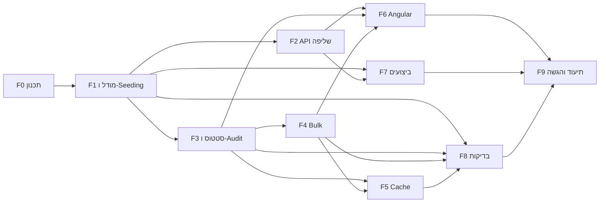

# תוכנית עבודה וחלוקה למשימות

מסמך זה מתרגם את אפיון המבדק לתוכנית עבודה: ניתוח פערים מול הקוד הקיים, חלוקה ל-Features ו-Tasks, תלויות, סדר ביצוע, הערכת מאמץ ומיפוי לדרישות.

> סימון סעיפי דרישה: `R1`–`R11` לפי מספור הסעיפים באפיון (R1 שליפת נתונים … R11 תיעוד).

---

## 1. נקודת מוצא – ניתוח פערים

הפרויקט הקיים מכיל בסיס עובד: API לשליפה עם דפדוף/סינון/מיון בצד השרת, Summary, עדכון סטטוס עם RowVersion, ממשק Angular עם debounce ו-`switchMap`, ו-9 בדיקות backend מול InMemory.

| דרישה | מצב | פער |
|---|---|---|
| R1 שדה `AssignedTo` | ❌ | חסר בישות, ב-DTO, ב-Seeder וב-UI |
| R1 100,000 רשומות + יצירה חוזרת | ⚠️ | ה-Seeder יוצר 12,000, ורק כשהטבלה ריקה; אין דרך ליצור מחדש |
| R1 סינון משולב | ⚠️ | קיים Status/Priority בלבד; חסרים OrganizationName, AssignedTo, טווח תאריכים |
| R1 חיפוש ב-Title/OrganizationName | ✅ | `Contains` → `LIKE '%x%'` (לא sargable – לתעד) |
| R1 מיון ≥3 שדות Asc/Desc | ✅ | 4 שדות, whitelist |
| R1 ≥2 Aggregations | ✅ | לפי Status ולפי Priority |
| R1 הגבלת PageSize, Validation, CancellationToken, DTOs | ✅ | חסרה ולידציה ל-`from <= to` (ייווסף עם טווח התאריכים) |
| R1 תיעוד מניעת טעינה לזיכרון + אינדקסים | ⚠️ | קיים חלקית ב-README; צריך לעדכן לאינדקסים החדשים |
| R2 404 / סטטוס לא חוקי | ✅ | |
| R2 מעבר סטטוס לא מותר | ❌ | אין מדיניות מעברים |
| R2 Optimistic Concurrency, UpdatedAt/RowVersion | ✅ | נאכף ב-DB באמצעות `rowversion` |
| R3 Audit + Endpoint היסטוריה | ❌ | חסר לגמרי |
| R4 Bulk עד 100 | ❌ | חסר לגמרי |
| R5 Angular – debounce, ביטול בקשות, מצבי Loading/Empty/Error, 409, Aggregations | ✅ | |
| R5 צפייה בהיסטוריה, פילטרים חדשים | ❌ | |
| R6 Execution Plan, אינדקסים, Bottleneck על 100K | ❌ | לא נמדד ולא תועד (נבדק רק מול 12K) |
| R7 Cache + Invalidation + Scale-out | ❌ | חסר; ה-README מציין זאת כ"שיפור עתידי" |
| R8 Integration Test (API + DB) | ❌ | כל הבדיקות הן Unit מול InMemory |
| R8 Concurrency / Validation / תרחיש תקין | ✅ | ברמת Service |
| R9 תוכנית עבודה | ❌ | המסמך הזה |
| R10 איכות קוד | ⚠️ | המיפוי Entity→DTO משוכפל ב-`RequestService`; ה-Logging מינימלי |
| R11 תיעוד | ⚠️ | ה-README מתאר גרסה קודמת ("האתגר שנבחר"); חסרים Cache, Bulk, Audit, מגבלה ידועה, פירוט AI |

---

## 2. החלטות תכנון שנדרשות לפני הפיתוח

| # | החלטה | הצעה | נימוק |
|---|---|---|---|
| D1 | מדיניות מעברי סטטוס | `New→InProgress`, `InProgress→Waiting/Completed`, `Waiting→InProgress/Completed`, `Completed` סופי; מעבר לאותו סטטוס נדחה | פשוט, ניתן לבדיקה, ומונע "קפיצה" ישירה מ-New ל-Completed |
| D2 | זהות `ChangedBy` ללא Authentication | Header `X-User-Name` (חובה בעדכון, אורך מוגבל), עם נקודת החלפה אחת (`ICurrentUser`) | אין מערכת הזדהות במבדק; כך המעבר ל-JWT בעתיד הוא שינוי במקום אחד |
| D3 | התנהגות Bulk | **Partial Success** – כל פנייה מעודכנת בטרנזקציה משלה; התשובה מכילה תוצאה לכל פנייה (`Updated` / `NotFound` / `Conflict` / `InvalidTransition`) | לכל פנייה RowVersion נפרד, ומקובל שמשתמשים אחרים עדכנו חלק מהפניות. All-or-Nothing היה מכשיל 99 עדכונים תקינים בגלל קונפליקט אחד ומאלץ את המשתמש לנסות שוב בלולאה |
| D4 | מה נשמר ב-Cache | ה-Summary (Aggregations על כל הטבלה) ב-`IMemoryCache`, Expiration של 60 שניות + Invalidation בכל שינוי סטטוס | זו השאילתה היקרה ביותר, הנקראת בכל טעינת מסך, והתוצאה זהה לכל המשתמשים. רשימות מסוננות לא נשמרות: מרחב המפתחות גדול מדי ו-Invalidation שלהן מורכב |
| D5 | DB לבדיקות אינטגרציה | `WebApplicationFactory` + SQL Server אמיתי (LocalDB עם DB ייחודי לכל הרצה, או Testcontainers אם Docker זמין) | InMemory לא אוכף `rowversion` ולא מתרגם ל-SQL, כך שלא בודק את מנגנון ה-Concurrency האמיתי |
| D6 | Seeding של 100K | הכנסה ב-batches עם `AutoDetectChanges` כבוי (או `SqlBulkCopy` אם עדיין איטי); יצירה מחדש באמצעות `dotnet run -- --reseed` | זמן עלייה סביר ושחזור דטרמיניסטי של הנתונים לפי דרישה |

---

## 3. חלוקה ל-Features ו-Tasks

הערכות המאמץ בשעות עבודה (h) וכוללות בדיקה ידנית של כל משימה.

### F0 – ניתוח ותכנון
| ID | משימה | תוצר מצופה | תלוי ב- | הערכה | דרישה |
|---|---|---|---|---|---|
| T0.1 | ניתוח פערים בין האפיון לקוד הקיים | טבלת פערים (סעיף 1) | – | 1h | R9 |
| T0.2 | קבלת החלטות D1–D6 | טבלת החלטות (סעיף 2) | T0.1 | 1h | R2, R4, R7, R9 |
| T0.3 | תוכנית עבודה, תלויות והערכות | מסמך זה | T0.2 | 1.5h | R9 |

### F1 – מודל נתונים ו-Seeding
| ID | משימה | תוצר מצופה | תלוי ב- | הערכה | דרישה |
|---|---|---|---|---|---|
| T1.1 | הוספת `AssignedTo` לישות ולקונפיגורציה (nvarchar(100), required) | Migration + עדכון `RequestEntity`/`RequestConfiguration` | T0.2 | 1h | R1 |
| T1.2 | ישות `RequestStatusHistory` (Id, RequestId FK, PreviousStatus, NewStatus, ChangedAt, ChangedBy) עם אינדקס `(RequestId, ChangedAt)` | Migration + Configuration | T0.2 | 1.5h | R3 |
| T1.3 | הרחבת ה-Seeder ל-100,000 רשומות כולל `AssignedTo` ופיזור סביר של ארגונים/מטפלים, הכנסה ב-batches | Seeder דטרמיניסטי; זמן seeding מתועד | T1.1 | 2h | R1 |
| T1.4 | יצירה חוזרת של נתוני הבדיקה (`--reseed`: מחיקה ו-seeding מחדש) | פקודה מתועדת ב-README | T1.3 | 1h | R1 |
| T1.5 | תכנון אינדקסים מחדש לפי תרחישי הסינון החדשים (`AssignedTo`, `OrganizationName`, טווח `CreatedAt`), בלי לשכפל אינדקסים קיימים | Migration + הערה לכל אינדקס: איזה תרחיש הוא משרת | T1.1 | 2h | R1, R6 |

### F2 – API שליפה
| ID | משימה | תוצר מצופה | תלוי ב- | הערכה | דרישה |
|---|---|---|---|---|---|
| T2.1 | הרחבת `RequestQueryDto`: `OrganizationName`, `AssignedTo`, `CreatedFrom`, `CreatedTo` + ולידציה (`from <= to`, אורכי מחרוזות) | סינון משולב ב-`GetRequestsAsync`, 400 ProblemDetails לקלט לא תקין | T1.1 | 1.5h | R1 |
| T2.2 | ריכוז המיפוי Entity→DTO ב-Projection אחד (`Expression`) לשימוש בשליפה ובעדכון | הסרת שכפול; DTO כולל `AssignedTo` | T1.1 | 1h | R1, R10 |
| T2.3 | תיעוד: איך נמנעת טעינת הנתונים לזיכרון (`IQueryable` עד `ToListAsync`, `Skip/Take` ב-SQL, `AsNoTracking`, Projection) | סעיף ב-README | T2.1 | 0.5h | R1, R11 |

### F3 – עדכון סטטוס, מעברים ו-Audit
| ID | משימה | תוצר מצופה | תלוי ב- | הערכה | דרישה |
|---|---|---|---|---|---|
| T3.1 | מדיניות מעברי סטטוס (`StatusTransitionPolicy`) לפי D1 | 400 עם הודעה ברורה ("Cannot change status from X to Y") | T0.2 | 1.5h | R2 |
| T3.2 | `ICurrentUser` שקורא את `X-User-Name` + ולידציה | שירות Scoped; 400 כשחסר | T0.2 | 1h | R3 |
| T3.3 | כתיבת רשומת Audit באותו `SaveChanges` של העדכון (אטומי: אין עדכון בלי Audit ולהפך) | שורת היסטוריה לכל שינוי סטטוס | T1.2, T3.1, T3.2 | 1h | R3 |
| T3.4 | `GET /api/requests/{id}/history` (ממוין לפי `ChangedAt` desc, 404 אם הפנייה לא קיימת) | Endpoint + DTO | T3.3 | 1h | R3 |
| T3.5 | Logging בנקודות משמעותיות: עדכון, Conflict, Bulk summary, reseed. בלי תוכן הפנייה ובלי ערכי Header | לוגים מובנים | T3.3 | 0.5h | R10 |

### F4 – עדכון Bulk
| ID | משימה | תוצר מצופה | תלוי ב- | הערכה | דרישה |
|---|---|---|---|---|---|
| T4.1 | חוזה API: `POST /api/requests/status/bulk` עם `{ status, items: [{ id, rowVersion }] }`; ולידציה ל-1–100 פריטים וללא מזהים כפולים | DTOs + תיעוד חוזה | T3.1 | 1h | R4 |
| T4.2 | מימוש Partial Success (D3): טעינת הפניות בשאילתה אחת, עדכון כל פנייה בטרנזקציה נפרדת עם RowVersion משלה ו-Audit, ו-`ChangeTracker.Clear()` בין פריטים | `200` עם `{ updated, failed, results[] }`, כולל RowVersion חדש לכל פנייה שעודכנה | T4.1, T3.3 | 3h | R4, R2 |

### F5 – Cache
| ID | משימה | תוצר מצופה | תלוי ב- | הערכה | דרישה |
|---|---|---|---|---|---|
| T5.1 | Cache ל-Summary ב-`IMemoryCache` (AbsoluteExpiration 60s) | `GetSummaryAsync` מחזיר מה-Cache כשאפשר | – | 1h | R7 |
| T5.2 | Invalidation אחרי עדכון בודד, אחרי Bulk (אם עודכנה לפחות פנייה אחת) ואחרי reseed | אין נתון מיושן אחרי שינוי באותו מופע | T5.1, T3.3, T4.2 | 1h | R7 |
| T5.3 | תיעוד Scale-out: מעבר ל-`IDistributedCache` (Redis), מחיקת המפתח המשותף בכל עדכון או מפתח עם גרסה; ה-Expiration הקצר מגביל את חלון הנתון המיושן | סעיף ב-README | T5.2 | 0.5h | R7, R11 |

### F6 – Angular
| ID | משימה | תוצר מצופה | תלוי ב- | הערכה | דרישה |
|---|---|---|---|---|---|
| T6.1 | עדכון מודלים ו-`RequestsService`: `assignedTo`, פילטרים חדשים, `getHistory`, `bulkUpdateStatus`, Header `X-User-Name` דרך interceptor | Service מלא מול ה-API | T2.1, T3.4, T4.1 | 1h | R5 |
| T6.2 | פילטרים: ארגון, מטפל, טווח תאריכים (Datepicker) בתוך זרם ה-debounce הקיים | סינון משולב בצד השרת | T6.1 | 2h | R5 |
| T6.3 | עמודת `AssignedTo` בטבלה | – | T6.1 | 0.5h | R5 |
| T6.4 | קומפוננטת היסטוריה (Dialog) עם מצבי Loading/Empty/Error | צפייה בהיסטוריה מכל שורה | T6.1 | 2h | R5, R3 |
| T6.5 | בחירת סטטוס שמציגה רק מעברים מותרים, וטיפול ב-400 (מעבר לא חוקי) לצד 409 הקיים | UX עקבי מול השרת | T6.1, T3.1 | 1h | R5, R2 |
| T6.6 | Bulk: בחירת שורות (Checkbox), סרגל פעולה ותצוגת תוצאה ("עודכנו 8, נכשלו 2 – קונפליקט"), ואז ריענון | פעולת Bulk מלאה | T6.1, T4.2 | 3h | R5, R4 |
| T6.7 | בדיקות Vitest לפילטרים החדשים, להיסטוריה ול-Bulk | specs עוברים | T6.2–T6.6 | 2h | R8 |

### F7 – ביצועים
| ID | משימה | תוצר מצופה | תלוי ב- | הערכה | דרישה |
|---|---|---|---|---|---|
| T7.1 | מדידה על 100K רשומות של `GET /api/requests` (פילטר משולב + מיון + עמוד עמוק), חיפוש טקסט ו-Summary: Actual Execution Plan + `SET STATISTICS IO, TIME` לפני ואחרי האינדקסים | צילומי Plan + טבלת logical reads / זמן | T1.3, T1.5, T2.1 | 3h | R6 |
| T7.2 | `docs/PERFORMANCE.md`: האינדקסים והסיבה לכל אחד, ה-Bottlenecks (`LIKE '%x%'` → Full-Text; OFFSET עמוק → Keyset pagination; `COUNT(*)` בכל עמוד) והשיפורים המוצעים | מסמך ביצועים | T7.1 | 1.5h | R6, R11 |

### F8 – בדיקות אוטומטיות
| ID | משימה | תוצר מצופה | תלוי ב- | הערכה | דרישה |
|---|---|---|---|---|---|
| T8.1 | תשתית Integration: `WebApplicationFactory` + SQL Server אמיתי (D5), DB ייחודי לכל הרצה ונתוני בדיקה קטנים | פרויקט `RequestsManagement.IntegrationTests` | T1.1, T1.2 | 2.5h | R8 |
| T8.2 | Integration – תרחיש תקין: `GET` עם סינון משולב, מיון ודפדוף דרך HTTP | בדיקה עוברת | T8.1, T2.1 | 1h | R8 |
| T8.3 | Integration – Concurrency: שני `PATCH` עם אותו RowVersion → אחד `200`, השני `409` | בדיקה עוברת מול `rowversion` אמיתי | T8.1, T3.3 | 1h | R8, R2 |
| T8.4 | Validation: מעבר לא חוקי, `pageSize > 100`, `from > to`, Bulk עם יותר מ-100 פריטים → `400` ProblemDetails | בדיקות עוברות | T3.1, T4.1 | 1h | R8 |
| T8.5 | Bulk Partial Success: פנייה קיימת + פנייה לא קיימת + RowVersion מיושן → תוצאה נכונה לכל פריט | בדיקה עוברת | T4.2 | 1h | R8, R4 |
| T8.6 | Audit + History: אחרי עדכון נוצרת שורת היסטוריה נכונה ו-Endpoint ההיסטוריה מחזיר אותה | בדיקה עוברת | T3.4 | 0.5h | R8, R3 |
| T8.7 | Cache: קריאה שנייה מגיעה מה-Cache, ואחרי עדכון מוחזר ערך מעודכן | בדיקה עוברת | T5.2 | 0.5h | R8, R7 |

### F9 – תיעוד והיערכות להרצה
| ID | משימה | תוצר מצופה | תלוי ב- | הערכה | דרישה |
|---|---|---|---|---|---|
| T9.1 | שכתוב README: הרצה, טכנולוגיות וגרסאות, מבנה, DB ואינדקסים, Concurrency, Bulk, Cache, שתי החלטות טכנולוגיות וחלופות, מגבלה ידועה ושיפור | README מלא | כל ה-Features | 2h | R11 |
| T9.2 | פירוט שימוש ב-AI: באילו חלקים, ומה נבדק או שונה ידנית | סעיף ב-README | T9.1 | 0.5h | R11 |
| T9.3 | בדיקת הרצה מ-clone נקי (backend, frontend, בדיקות), קובץ `.http` מעודכן, Swagger | הוראות הרצה שעובדות | T9.1 | 1h | R11 |
| T9.4 | Code Review סופי ותיקונים (שכפול, Naming, Lifetimes, Async) | קוד נקי | כל ה-Features | 1.5h | R10 |
| T9.5 | העלאה ל-GitHub (ריפו נגיש לבודקים) ובדיקה שכל המסמכים מקושרים מה-README | קישור הגשה | T9.3, T9.4 | 0.5h | הגשה |

---

## 4. סדר ביצוע ותלויות

**שלבים:**

1. **יסודות (יום 1):** F0 ← T1.1, T1.2 (Migrations) ← T1.3, T1.4. בלי המודל המעודכן אין טעם להתחיל לעבוד על ה-API או על ה-UI.
2. **Backend (ימים 2–3):** F2 ו-F3 במקביל, ואחריהם F4 ו-F5. התשתית של T8.1 נבנית כבר בשלב הזה, כך שבדיקות האינטגרציה נכתבות יחד עם הפיצ'ר ולא בסוף.
3. **Frontend + ביצועים (ימים 4–5):** F6 מול ה-API המוגמר. במקביל F7, כי הוא תלוי רק ב-Seeder, באינדקסים וב-T2.1. ייתכן שממצאי F7 יחזירו שינוי לאינדקסים ב-T1.5.
4. **סגירה (יום 6):** השלמת F8, ואחריה F9.

**הנתיב הקריטי:** T1.1 → T1.2 → T3.1 → T3.3 → T4.2 → T6.6 → T9.1.

---

## 5. סיכום מאמץ

| Feature | שעות |
|---|---|
| F0 תכנון | 3.5 |
| F1 מודל ו-Seeding | 7.5 |
| F2 API שליפה | 3 |
| F3 סטטוס ו-Audit | 5 |
| F4 Bulk | 4 |
| F5 Cache | 2.5 |
| F6 Angular | 11.5 |
| F7 ביצועים | 4.5 |
| F8 בדיקות | 7.5 |
| F9 תיעוד והגשה | 5.5 |
| **סה"כ** | **54.5h (כ-7 ימי עבודה)** |

רזרבה מומלצת: 15% (כ-8h). המקורות העיקריים לסיכון הם זמן ה-Seeding של 100K רשומות, הקמת SQL Server לבדיקות האינטגרציה, וממצאי ביצועים שיחייבו שינוי אינדקסים.

---

## 6. מיפוי דרישות → משימות

| דרישה | משימות |
|---|---|
| R1 שליפת נתונים | T1.1, T1.3, T1.4, T1.5, T2.1, T2.2, T2.3 |
| R2 סטטוס ותחרותיות | T3.1, T4.2, T6.5, T8.3 |
| R3 היסטוריית שינויים | T1.2, T3.2, T3.3, T3.4, T6.4, T8.6 |
| R4 Bulk | T0.2 (D3), T4.1, T4.2, T6.6, T8.5 |
| R5 Angular | T6.1–T6.7 |
| R6 ביצועים | T1.5, T7.1, T7.2 |
| R7 Cache | T0.2 (D4), T5.1, T5.2, T5.3, T8.7 |
| R8 בדיקות | T8.1–T8.7, T6.7 |
| R9 תכנון עבודה | T0.1, T0.2, T0.3 |
| R10 איכות קוד | T2.2, T3.5, T9.4 |
| R11 תיעוד | T2.3, T5.3, T7.2, T9.1, T9.2, T9.3 |
