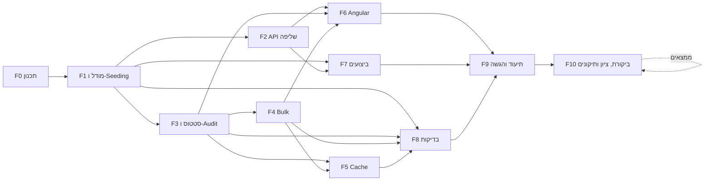

# תוכנית עבודה וחלוקה למשימות

מסמך זה מתרגם את אפיון המבדק לתוכנית עבודה: ניתוח פערים מול הקוד הקיים, חלוקה ל-Features ו-Tasks, תלויות, סדר ביצוע, הערכת מאמץ ומיפוי לדרישות.

> סימון סעיפי דרישה: `R1`–`R11` לפי מספור הסעיפים באפיון (R1 שליפת נתונים … R11 תיעוד).

---

## 1. נקודת מוצא – ניתוח פערים

> **הערה לגבי הקוד הקיים:** חלק מהקוד היה קיים עוד לפני תחילת המבדק הנוכחי. בעבר ניגשתי למשרה במשרד להגנת הסביבה, ובמבדק שם ניתן אותו בסיס פרויקט. השתמשתי בבסיס הזה כנקודת מוצא, והמבדק הנוכחי נבנה מעליו.

הפרויקט הקיים מכיל בסיס עובד: API לשליפה עם דפדוף/סינון/מיון בצד השרת, Summary, עדכון סטטוס עם RowVersion, ממשק Angular עם debounce ו-`switchMap`, ו-9 בדיקות backend מול InMemory.

| דרישה | מצב | פער |
|---|---|---|
| R1 שדה `AssignedTo` | ❌ | חסר בישות, ב-DTO, ב-Seeder וב-UI |
| R1 100,000 רשומות + יצירה חוזרת | ⚠️ | ה-Seeder יוצר 12,000, ורק כשהטבלה ריקה; אין דרך ליצור מחדש |
| R1 סינון משולב | ⚠️ | קיים Status/Priority בלבד; חסרים OrganizationName, AssignedTo, טווח תאריכים |
| R1 חיפוש ב-Title/OrganizationName | ✅ | `Contains` → `LIKE '%x%'` (לא sargable – לתעד) |
| R1 מיון ≥3 שדות Asc/Desc | ✅ | 4 שדות, whitelist |
| R1 ≥2 Aggregations | ✅ | לפי Status ולפי Priority |
| R1 הגבלת PageSize, Validation, CancellationToken, DTOs | ✅ | חסרה ולידציה ל-`from <= to` (ייווסף עם טווח התאריכים) |
| R1 תיעוד מניעת טעינה לזיכרון + אינדקסים | ⚠️ | קיים חלקית ב-README; צריך לעדכן לאינדקסים החדשים |
| R2 404 / סטטוס לא חוקי | ✅ | |
| R2 מעבר סטטוס לא מותר | ❌ | אין מדיניות מעברים |
| R2 Optimistic Concurrency, UpdatedAt/RowVersion | ✅ | נאכף ב-DB באמצעות `rowversion` |
| R3 Audit + Endpoint היסטוריה | ❌ | חסר לגמרי |
| R4 Bulk עד 100 | ❌ | חסר לגמרי |
| R5 Angular – debounce, ביטול בקשות, מצבי Loading/Empty/Error, 409, Aggregations | ✅ | |
| R5 צפייה בהיסטוריה, פילטרים חדשים | ❌ | |
| R6 Execution Plan, אינדקסים, Bottleneck על 100K | ❌ | לא נמדד ולא תועד (נבדק רק מול 12K) |
| R7 Cache + Invalidation + Scale-out | ❌ | חסר; ה-README מציין זאת כ"שיפור עתידי" |
| R8 Integration Test (API + DB) | ❌ | כל הבדיקות הן Unit מול InMemory |
| R8 Concurrency / Validation / תרחיש תקין | ✅ | ברמת Service |
| R9 תוכנית עבודה | ❌ | המסמך הזה |
| R10 איכות קוד | ⚠️ | המיפוי Entity→DTO משוכפל ב-`RequestService`; ה-Logging מינימלי |
| R11 תיעוד | ⚠️ | ה-README מתאר גרסה קודמת ("האתגר שנבחר"); חסרים Cache, Bulk, Audit, מגבלה ידועה, פירוט AI |

---

## 2. החלטות תכנון שנדרשות לפני הפיתוח

| # | החלטה | הצעה | נימוק |
|---|---|---|---|
| D1 | מדיניות מעברי סטטוס | `New→InProgress`, `InProgress→Waiting/Completed`, `Waiting→InProgress/Completed`, `Completed` סופי; מעבר לאותו סטטוס נדחה | פשוט, ניתן לבדיקה, ומונע "קפיצה" ישירה מ-New ל-Completed |
| D2 | זהות `ChangedBy` ללא Authentication | Header `X-User-Name` (חובה בעדכון, אורך מוגבל), עם נקודת החלפה אחת (`ICurrentUser`) | אין מערכת הזדהות במבדק; כך המעבר ל-JWT בעתיד הוא שינוי במקום אחד |
| D3 | התנהגות Bulk | **Partial Success** – כל פנייה מעודכנת בטרנזקציה משלה; התשובה מכילה תוצאה לכל פנייה (`Updated` / `NotFound` / `Conflict` / `InvalidTransition`) | לכל פנייה RowVersion נפרד, ומקובל שמשתמשים אחרים עדכנו חלק מהפניות. All-or-Nothing היה מכשיל 99 עדכונים תקינים בגלל קונפליקט אחד ומאלץ את המשתמש לנסות שוב בלולאה |
| D4 | מה נשמר ב-Cache | ה-Summary (Aggregations על כל הטבלה) ב-`IMemoryCache`, Expiration של 60 שניות + Invalidation בכל שינוי סטטוס | זו השאילתה היקרה ביותר, הנקראת בכל טעינת מסך, והתוצאה זהה לכל המשתמשים. רשימות מסוננות לא נשמרות: מרחב המפתחות גדול מדי ו-Invalidation שלהן מורכב |
| D5 | DB לבדיקות אינטגרציה | `WebApplicationFactory` + SQL Server אמיתי (LocalDB עם DB ייחודי לכל הרצה, או Testcontainers אם Docker זמין) | InMemory לא אוכף `rowversion` ולא מתרגם ל-SQL, כך שלא בודק את מנגנון ה-Concurrency האמיתי |
| D6 | Seeding של 100K | הכנסה ב-batches עם `AutoDetectChanges` כבוי (או `SqlBulkCopy` אם עדיין איטי); יצירה מחדש באמצעות `dotnet run -- --reseed` | זמן עלייה סביר ושחזור דטרמיניסטי של הנתונים לפי דרישה |

---

## 3. חלוקה ל-Features ו-Tasks

הערכות המאמץ בשעות עבודה (h) וכוללות בדיקה ידנית של כל משימה. רוב הזמן הושקע בתכנון (F0, כ-4.5h). שאר המשימות קטנות וממוקדות: כל אחת עד 2h, ורובן פחות. החריגה היחידה היא T10.9 (סבבי תיקונים), שהיקפה תלוי בממצאים.

### F0 – ניתוח ותכנון
| ID | משימה | תוצר מצופה | תלוי ב- | הערכה | דרישה |
|---|---|---|---|---|---|
| T0.1 | ניתוח פערים בין האפיון לקוד הקיים | טבלת פערים (סעיף 1) | – | 1.5h | R9 |
| T0.2 | קבלת החלטות D1–D6 | טבלת החלטות (סעיף 2) | T0.1 | 1.5h | R2, R4, R7, R9 |
| T0.3 | תוכנית עבודה, תלויות והערכות | מסמך זה | T0.2 | 1.5h | R9 |

### F1 – מודל נתונים ו-Seeding
| ID | משימה | תוצר מצופה | תלוי ב- | הערכה | דרישה |
|---|---|---|---|---|---|
| T1.1 | הוספת `AssignedTo` לישות ולקונפיגורציה (nvarchar(100), required) | Migration + עדכון `RequestEntity`/`RequestConfiguration` | T0.2 | 0.5h | R1 |
| T1.2 | ישות `RequestStatusHistory` (Id, RequestId FK, PreviousStatus, NewStatus, ChangedAt, ChangedBy) עם אינדקס `(RequestId, ChangedAt)` | Migration + Configuration | T0.2 | 1h | R3 |
| T1.3 | הרחבת ה-Seeder ל-100,000 רשומות כולל `AssignedTo` ופיזור סביר של ארגונים/מטפלים, הכנסה ב-batches | Seeder דטרמיניסטי; זמן seeding מתועד | T1.1 | 2h | R1 |
| T1.4 | יצירה חוזרת של נתוני הבדיקה (`--reseed`: מחיקה ו-seeding מחדש) | פקודה מתועדת ב-README | T1.3 | 0.5h | R1 |
| T1.5 | תכנון אינדקסים מחדש לפי תרחישי הסינון החדשים (`AssignedTo`, `OrganizationName`, טווח `CreatedAt`), בלי לשכפל אינדקסים קיימים | Migration + הערה לכל אינדקס: איזה תרחיש הוא משרת | T1.1 | 1.5h | R1, R6 |

### F2 – API שליפה
| ID | משימה | תוצר מצופה | תלוי ב- | הערכה | דרישה |
|---|---|---|---|---|---|
| T2.1 | הרחבת `RequestQueryDto`: `OrganizationName`, `AssignedTo`, `CreatedFrom`, `CreatedTo` + ולידציה (`from <= to`, אורכי מחרוזות). בנוסף: הוספת `ThenBy(Id)` כ-tiebreaker לכל מיון (נמצא ב-T1.5: מיון לפי עמודה לא ייחודית כמו Status גורם לדפדוף לא דטרמיניסטי – שורות כפולות/חסרות בין עמודים; ה-Id כבר חלק ממפתח כל אינדקס non-clustered ולכן אין עלות) | סינון משולב ב-`GetRequestsAsync`, דפדוף יציב, 400 ProblemDetails לקלט לא תקין | T1.1 | 1.5h | R1 |
| T2.2 | ריכוז המיפוי Entity→DTO ב-Projection אחד (`Expression`) לשימוש בשליפה ובעדכון | הסרת שכפול; DTO כולל `AssignedTo` | T1.1 | 0.5h | R1, R10 |
| T2.3 | תיעוד: איך נמנעת טעינת הנתונים לזיכרון (`IQueryable` עד `ToListAsync`, `Skip/Take` ב-SQL, `AsNoTracking`, Projection) | סעיף ב-README | T2.1 | 0.5h | R1, R11 |

### F3 – עדכון סטטוס, מעברים ו-Audit
| ID | משימה | תוצר מצופה | תלוי ב- | הערכה | דרישה |
|---|---|---|---|---|---|
| T3.1 | מדיניות מעברי סטטוס (`StatusTransitionPolicy`) לפי D1 | 400 עם הודעה ברורה ("Cannot change status from X to Y") | T0.2 | 1h | R2 |
| T3.2 | `ICurrentUser` שקורא את `X-User-Name` + ולידציה | שירות Scoped; 400 כשחסר | T0.2 | 0.5h | R3 |
| T3.3 | כתיבת רשומת Audit באותו `SaveChanges` של העדכון (אטומי: אין עדכון בלי Audit ולהפך) | שורת היסטוריה לכל שינוי סטטוס | T1.2, T3.1, T3.2 | 1h | R3 |
| T3.4 | `GET /api/requests/{id}/history` (ממוין לפי `ChangedAt` desc, 404 אם הפנייה לא קיימת) | Endpoint + DTO | T3.3 | 0.5h | R3 |
| T3.5 | Logging בנקודות משמעותיות: עדכון, Conflict, Bulk summary, reseed. בלי תוכן הפנייה ובלי ערכי Header | לוגים מובנים | T3.3 | 0.5h | R10 |

### F4 – עדכון Bulk
| ID | משימה | תוצר מצופה | תלוי ב- | הערכה | דרישה |
|---|---|---|---|---|---|
| T4.1 | חוזה API: `POST /api/requests/status/bulk` עם `{ status, items: [{ id, rowVersion }] }`; ולידציה ל-1–100 פריטים וללא מזהים כפולים | DTOs + תיעוד חוזה | T3.1 | 0.5h | R4 |
| T4.2 | מימוש Partial Success (D3): טעינת הפניות בשאילתה אחת, עדכון כל פנייה בטרנזקציה נפרדת עם RowVersion משלה ו-Audit, ו-`ChangeTracker.Clear()` בין פריטים | `200` עם `{ updated, failed, results[] }`, כולל RowVersion חדש לכל פנייה שעודכנה | T4.1, T3.3 | 2h | R4, R2 |

### F5 – Cache
| ID | משימה | תוצר מצופה | תלוי ב- | הערכה | דרישה |
|---|---|---|---|---|---|
| T5.1 | Cache ל-Summary ב-`IMemoryCache` (AbsoluteExpiration 60s) | `GetSummaryAsync` מחזיר מה-Cache כשאפשר | – | 0.5h | R7 |
| T5.2 | Invalidation אחרי עדכון בודד, אחרי Bulk (אם עודכנה לפחות פנייה אחת) ואחרי reseed | אין נתון מיושן אחרי שינוי באותו מופע | T5.1, T3.3, T4.2 | 0.5h | R7 |
| T5.3 | תיעוד Scale-out: מעבר ל-`IDistributedCache` (Redis), מחיקת המפתח המשותף בכל עדכון או מפתח עם גרסה; ה-Expiration הקצר מגביל את חלון הנתון המיושן | סעיף ב-README | T5.2 | 0.5h | R7, R11 |

### F6 – Angular
| ID | משימה | תוצר מצופה | תלוי ב- | הערכה | דרישה |
|---|---|---|---|---|---|
| T6.1 | עדכון מודלים ו-`RequestsService`: `assignedTo`, פילטרים חדשים, `getHistory`, `bulkUpdateStatus`, Header `X-User-Name` דרך interceptor | Service מלא מול ה-API | T2.1, T3.4, T4.1 | 1h | R5 |
| T6.2 | פילטרים: ארגון, מטפל, טווח תאריכים (Datepicker) בתוך זרם ה-debounce הקיים | סינון משולב בצד השרת | T6.1 | 1.5h | R5 |
| T6.3 | עמודת `AssignedTo` בטבלה | – | T6.1 | 0.5h | R5 |
| T6.4 | קומפוננטת היסטוריה (Dialog) עם מצבי Loading/Empty/Error | צפייה בהיסטוריה מכל שורה | T6.1 | 1.5h | R5, R3 |
| T6.5 | בחירת סטטוס שמציגה רק מעברים מותרים, וטיפול ב-400 (מעבר לא חוקי) לצד 409 הקיים | UX עקבי מול השרת | T6.1, T3.1 | 1h | R5, R2 |
| T6.6 | Bulk: בחירת שורות (Checkbox), סרגל פעולה ותצוגת תוצאה ("עודכנו 8, נכשלו 2 – קונפליקט"), ואז ריענון | פעולת Bulk מלאה | T6.1, T4.2 | 2h | R5, R4 |
| T6.7 | בדיקות Vitest לפילטרים החדשים, להיסטוריה ול-Bulk | specs עוברים | T6.2–T6.6 | 1.5h | R8 |

### F7 – ביצועים
| ID | משימה | תוצר מצופה | תלוי ב- | הערכה | דרישה |
|---|---|---|---|---|---|
| T7.1 | מדידה על 100K רשומות של `GET /api/requests` (פילטר משולב + מיון + עמוד עמוק), חיפוש טקסט ו-Summary: Actual Execution Plan + `SET STATISTICS IO, TIME` לפני ואחרי האינדקסים | צילומי Plan + טבלת logical reads / זמן | T1.3, T1.5, T2.1 | 2h | R6 |
| T7.2 | `docs/PERFORMANCE.md`: האינדקסים והסיבה לכל אחד, ה-Bottlenecks (`LIKE '%x%'` → Full-Text; OFFSET עמוק → Keyset pagination; `COUNT(*)` בכל עמוד) והשיפורים המוצעים | מסמך ביצועים | T7.1 | 1h | R6, R11 |

### F8 – בדיקות אוטומטיות
| ID | משימה | תוצר מצופה | תלוי ב- | הערכה | דרישה |
|---|---|---|---|---|---|
| T8.1 | תשתית Integration: `WebApplicationFactory` + SQL Server אמיתי (D5), DB ייחודי לכל הרצה ונתוני בדיקה קטנים | פרויקט `RequestsManagement.IntegrationTests` | T1.1, T1.2 | 2h | R8 |
| T8.2 | Integration – תרחיש תקין: `GET` עם סינון משולב, מיון ודפדוף דרך HTTP | בדיקה עוברת | T8.1, T2.1 | 0.5h | R8 |
| T8.3 | Integration – Concurrency: שני `PATCH` עם אותו RowVersion → אחד `200`, השני `409`. בנוסף: קונפליקט שמתגלה רק ב-`SaveChanges` (כותב מתחרה בין הטעינה לשמירה, באמצעות `SaveChangesInterceptor`) → שורת ההיסטוריה מתבטלת יחד עם ה-UPDATE. הועבר מ-T3.3: ספק InMemory אינו תומך בטרנזקציות ולכן אינו יכול לאמת זאת | בדיקה עוברת מול `rowversion` וטרנזקציה אמיתיים | T8.1, T3.3 | 1h | R8, R2, R3 |
| T8.4 | Validation: מעבר לא חוקי, `pageSize > 100`, `from > to`, Bulk עם יותר מ-100 פריטים → `400` ProblemDetails | בדיקות עוברות | T3.1, T4.1 | 0.5h | R8 |
| T8.5 | Bulk Partial Success: פנייה קיימת + פנייה לא קיימת + RowVersion מיושן → תוצאה נכונה לכל פריט | בדיקה עוברת | T4.2 | 0.5h | R8, R4 |
| T8.6 | Audit + History: אחרי עדכון נוצרת שורת היסטוריה נכונה ו-Endpoint ההיסטוריה מחזיר אותה | בדיקה עוברת | T3.4 | 0.5h | R8, R3 |
| T8.7 | Cache: קריאה שנייה מגיעה מה-Cache, ואחרי עדכון מוחזר ערך מעודכן | בדיקה עוברת | T5.2 | 0.5h | R8, R7 |

### F9 – תיעוד והיערכות להרצה
| ID | משימה | תוצר מצופה | תלוי ב- | הערכה | דרישה |
|---|---|---|---|---|---|
| T9.1 | שכתוב README: הרצה, טכנולוגיות וגרסאות, מבנה, DB ואינדקסים, Concurrency, Bulk, Cache, שתי החלטות טכנולוגיות וחלופות, מגבלה ידועה ושיפור | README מלא | כל ה-Features | 1h | R11 |
| T9.2 | פירוט שימוש ב-AI: באילו חלקים, ומה נבדק או שונה ידנית | סעיף ב-README | T9.1 | 0.5h | R11 |
| T9.3 | בדיקת הרצה מ-clone נקי (backend, frontend, בדיקות), קובץ `.http` מעודכן, Swagger | הוראות הרצה שעובדות | T9.1 | 0.5h | R11 |

> ה-Code Review הסופי וההגשה (לשעבר T9.4, T9.5) הועברו ל-F10, כדי שההגשה תתבצע רק אחרי שהפרויקט עבר את ה-Quality Gate.

### F10 – Quality Gate: ביקורת סופית, ציון ותיקונים

**המטרה:** לבחון את כל מה שנבנה ב-F1–F9 מנקודת המבט של הבודק. כל ממצא מסווג, מתוקן ונבדק שוב, עד שהפרויקט עומד ברף שמוגדר למטה.

**כלל ההיקף:** מתקנים רק את מה שנגזר מהאפיון (R1–R11), או בעיות איכות, אבטחה ונכונות בקוד שכבר נכתב. לא מוסיפים פיצ'רים שלא נדרשו, כמו Authentication, Rate Limiting או Full-Text Search. הצעות שמחוץ להיקף נרשמות ב"מה הייתי משפר" ב-README, ולא נכנסות לקוד.

**סיווג ממצאים:**

| חומרה | הגדרה | טיפול |
|---|---|---|
| Critical | דרישה חסרה, באג שמשבש נתונים, או פרצת אבטחה | חובה לתקן |
| High | דרישה ממומשת חלקית, באג בתרחיש סביר, או דרישה בלי בדיקה | חובה לתקן |
| Medium | Code smell, חוסר עקביות, או תיעוד לא מדויק | מתקנים אם זה בהיקף. אחרת, נימוק מתועד |
| Low | סגנון או Naming | מתקנים אם זה זול |

**Scorecard:** ציון 1–10 לכל ממד. 10 = אין ממצא פתוח מעבר ל-Low. 8–9 = נשארו Medium פתוחים עם נימוק. 7 ומטה = יש High או Critical פתוח.

| ממד | משקל | מה נבדק | דרישות |
|---|---|---|---|
| עמידה בדרישות | 25% | כל תת-דרישה באפיון ממומשת, נבדקת ומתועדת | R1–R7 |
| איכות קוד Backend | 15% | ארכיטקטורה, SOLID, Async, EF, טיפול בשגיאות, Logging | R10 |
| איכות קוד Frontend | 10% | מבנה, Typing, ניהול Subscriptions, מצבי UI, נגישות בסיסית | R5, R10 |
| אבטחה | 10% | ולידציה, Injection, דליפת מידע, CORS, חבילות פגיעות | R1–R4, R10 |
| בדיקות | 15% | כיסוי לכל דרישה, מקרי קצה, Integration מול DB אמיתי | R8 |
| ביצועים ו-Cache | 10% | Plans, אינדקסים, N+1, Invalidation | R6, R7 |
| תיעוד ותכנון | 15% | README מדויק מול הקוד, תוכנית עבודה, החלטות ומגבלות | R9, R11 |

| ID | משימה | תוצר מצופה | תלוי ב- | הערכה | דרישה |
|---|---|---|---|---|---|
| T10.1 | **בדיקת עמידה בדרישות.** פירוק האפיון לרשימה של כל משפט-דרישה, ולא רק לרמת R1–R11. לכל פריט מתעדים: איפה הוא ממומש (קובץ ושורה), איזו בדיקה מכסה אותו ואיפה הוא מתועד. פריט שחסר לו אחד מהשלושה הוא ממצא | מטריצת Traceability ב-`docs/REVIEW.md` | F1–F9 | 1.5h | R1–R11 |
| T10.2 | **Code Review ל-Backend.** Controller דק ולוגיקה ב-Service, SOLID, שכפול, Naming, Nullable, DI lifetimes, `CancellationToken` עד ה-DB, Async נכון (בלי `.Result` / `.Wait()`), שימוש ב-EF (Tracking, Projection, N+1, טרנזקציות), עקביות של ProblemDetails ושל קודי HTTP, ורמות Logging. כלים: `dotnet build -warnaserror`, `dotnet format --verify-no-changes`, Roslyn analyzers ו-`/code-review` | רשימת ממצאים מסווגת | T10.1 | 1.5h | R10 |
| T10.3 | **Code Review ל-Frontend.** מבנה core/shared/features, Typing מלא (בלי `any`), ניהול Subscriptions (`takeUntilDestroyed` / `async` pipe), Signals ו-`OnPush`, ביטול בקשות, מצבי Loading/Empty/Error בכל מסך, נגישות בסיסית (labels, aria, ניווט מקלדת) ו-RTL. כלים: `ng build --configuration production` בלי אזהרות, lint | רשימת ממצאים מסווגת | T10.1 | 1h | R5, R10 |
| T10.4 | **Security Review** לפי OWASP Top 10, בהיקף הפרויקט: ולידציה לכל קלט (Query, Body, ו-Header `X-User-Name`: אורך, תווים ו-Log Injection), אין SQL דינמי או `FromSqlRaw` עם אינטרפולציה, אין Mass Assignment (DTO נפרד מה-Entity), אין דליפת Stack Trace או פרטי DB ב-Production, CORS מוגבל ל-origin של ה-UI, הגבלת גודל בקשה ב-Bulk, אין סודות בריפו, ואין XSS ב-Angular (`innerHTML`, `bypassSecurityTrust*`). בדיקת חבילות: `dotnet list package --vulnerable --include-transitive` ו-`npm audit`. כלי: `/security-review`. הזהות מבוססת Header (D2) מתועדת כמגבלה ידועה, ולא ממומש Authentication | רשימת ממצאים + סעיף אבטחה ב-README | T10.1 | 1.5h | R2, R3, R4, R10 |
| T10.5 | **Review לבדיקות.** הרצת כל הבדיקות מ-clone נקי, דוח Coverage (`coverlet` / `vitest --coverage`) ל-Services ול-Policies, ולפחות בדיקה אחת לכל דרישה (לפי T10.1). מקרי קצה: גבולות (`pageSize` 0/1/100/101, Bulk עם 0/1/100/101 פריטים), מזהים כפולים, מחרוזות ריקות, רווחים ו-Unicode, טווח תאריכים שבו from ו-to שווים. בנוסף: בדיקות לא יציבות (flaky) ובדיקות שתלויות בסדר ההרצה | פערי בדיקות כממצאים + דוח Coverage | T10.1 | 1h | R8 |
| T10.6 | **בדיקה חוזרת של ביצועים.** הרצה חוזרת של מדידות T7.1 על הקוד הסופי, כדי לוודא שהתיקונים לא שינו את ה-Plans. בדיקה ב-SQL logging שאין N+1 ב-Bulk ובהיסטוריה, ובדיקה ב-Network tab שה-UI לא שולח בקשות כפולות | טבלת ביצועים מעודכנת | T10.1 | 0.5h | R6, R7 |
| T10.7 | **Review לתיעוד.** כל טענה ב-README ובמסמכים מאומתת מול הקוד: מספר הבדיקות, שמות קבצים, Endpoints, פרמטרים ומדידות. הקישורים עובדים, הוראות ההרצה נבדקו בפועל, "מה הייתי משפר" כולל רק מה שבאמת לא נעשה, ותוכנית העבודה משקפת את מה שבוצע (סטיות מתועדות) | מסמכים מדויקים | T10.1 | 0.5h | R9, R11 |
| T10.8 | **ציון ראשוני.** איחוד הממצאים מ-T10.1–T10.7 לרשימה אחת, סיווג חומרה וסימון "בהיקף" / "מחוץ להיקף", ומילוי ה-Scorecard | Scorecard "לפני" + רשימת ממצאים ב-`docs/REVIEW.md` | T10.2–T10.7 | 0.5h | כולן |
| T10.9 | **סבב תיקונים.** כל ממצא Critical/High, וכל Medium שבהיקף. כל תיקון בקומיט נפרד, עם הפניה למזהה הממצא ובדיקה שמכסה אותו. אחרי הסבב: Review חוזר לאזורים שהשתנו וציון מחדש. חוזרים על הסבב עד עמידה ב-Definition of Done (צפי: 2 סבבים) | ממצאים סגורים + Scorecard "אחרי" | T10.8 | 3h | כולן |
| T10.10 | **הגשה.** העלאה ל-GitHub (ריפו נגיש לבודקים), בדיקה שכל המסמכים מקושרים מה-README, והרצה אחרונה מ-clone נקי | קישור הגשה | T10.9 | 0.5h | הגשה |

**Definition of Done ל-Quality Gate:**
- `dotnet build` ו-`ng build --configuration production` עוברים בלי אזהרות, ו-`dotnet format` וה-lint נקיים.
- כל הבדיקות עוברות: Unit ו-Integration ב-Backend, ו-Vitest ב-Frontend.
- אין חבילות עם פגיעות ברמת High או Critical.
- לכל תת-דרישה באפיון יש במטריצה מימוש, בדיקה ותיעוד.
- אין ממצא פתוח ברמת Critical או High. ממצא Medium נשאר פתוח רק עם נימוק מתועד.
- ציון 9 לפחות בכל ממד, ו-90 לפחות בציון המשוקלל.
- ה-README תואם את הקוד במלואו.

---

## 4. סדר ביצוע ותלויות

**שלבים:**

1. **יסודות (יום 1):** F0 ← T1.1, T1.2 (Migrations) ← T1.3, T1.4. בלי המודל המעודכן אין טעם להתחיל לעבוד על ה-API או על ה-UI.
2. **Backend (יום 2):** F2 ו-F3 במקביל, ואחריהם F4 ו-F5. התשתית של T8.1 נבנית כבר בשלב הזה, כך שבדיקות האינטגרציה נכתבות יחד עם הפיצ'ר ולא בסוף.
3. **Frontend + ביצועים (ימים 3–4):** F6 מול ה-API המוגמר. במקביל F7, כי הוא תלוי רק ב-Seeder, באינדקסים וב-T2.1. ייתכן שממצאי F7 יחזירו שינוי לאינדקסים ב-T1.5.
4. **סגירה (יום 5):** השלמת F8, ואחריה F9.
5. **Quality Gate (ימים 6–7):** F10. קודם בדיקת העמידה בדרישות (T10.1), כי היא מגדירה מה כל Review צריך לחפש. אחריה ה-Reviews (T10.2–T10.7), שאפשר להריץ במקביל, ואז ציון וסבבי תיקונים עד עמידה ב-Definition of Done. רק אז מגישים.

**הנתיב הקריטי:** T1.1 → T1.2 → T3.1 → T3.3 → T4.2 → T6.6 → T9.1 → T10.1 → T10.8 → T10.9 → T10.10.

---

## 5. סיכום מאמץ

| Feature | שעות |
|---|---|
| F0 תכנון | 4.5 |
| F1 מודל ו-Seeding | 5.5 |
| F2 API שליפה | 2.5 |
| F3 סטטוס ו-Audit | 3.5 |
| F4 Bulk | 2.5 |
| F5 Cache | 1.5 |
| F6 Angular | 9 |
| F7 ביצועים | 3 |
| F8 בדיקות | 5.5 |
| F9 תיעוד | 2 |
| F10 Quality Gate והגשה | 11.5 |
| **סה"כ** | **51h (כ-6.5 ימי עבודה)** |

רזרבה מומלצת: 15% (כ-7.5h). המקורות העיקריים לסיכון הם זמן ה-Seeding של 100K רשומות, הקמת SQL Server לבדיקות האינטגרציה, ממצאי ביצועים שיחייבו שינוי אינדקסים, וכמות הממצאים ב-Quality Gate, שקובעת כמה סבבי תיקונים יידרשו ב-T10.9.

---

## 6. מיפוי דרישות → משימות

| דרישה | משימות |
|---|---|
| R1 שליפת נתונים | T1.1, T1.3, T1.4, T1.5, T2.1, T2.2, T2.3 |
| R2 סטטוס ותחרותיות | T3.1, T4.2, T6.5, T8.3 |
| R3 היסטוריית שינויים | T1.2, T3.2, T3.3, T3.4, T6.4, T8.6 |
| R4 Bulk | T0.2 (D3), T4.1, T4.2, T6.6, T8.5 |
| R5 Angular | T6.1–T6.7 |
| R6 ביצועים | T1.5, T7.1, T7.2, T10.6 |
| R7 Cache | T0.2 (D4), T5.1, T5.2, T5.3, T8.7, T10.6 |
| R8 בדיקות | T8.1–T8.7, T6.7, T10.5 |
| R9 תכנון עבודה | T0.1, T0.2, T0.3, T10.7 |
| R10 איכות קוד | T2.2, T3.5, T10.2, T10.3, T10.4 |
| R11 תיעוד | T2.3, T5.3, T7.2, T9.1, T9.2, T9.3, T10.7 |
| כל הדרישות – אימות סופי | T10.1 (מטריצת Traceability), T10.8 (ציון), T10.9 (תיקונים) |
| הגשה | T10.10 |
